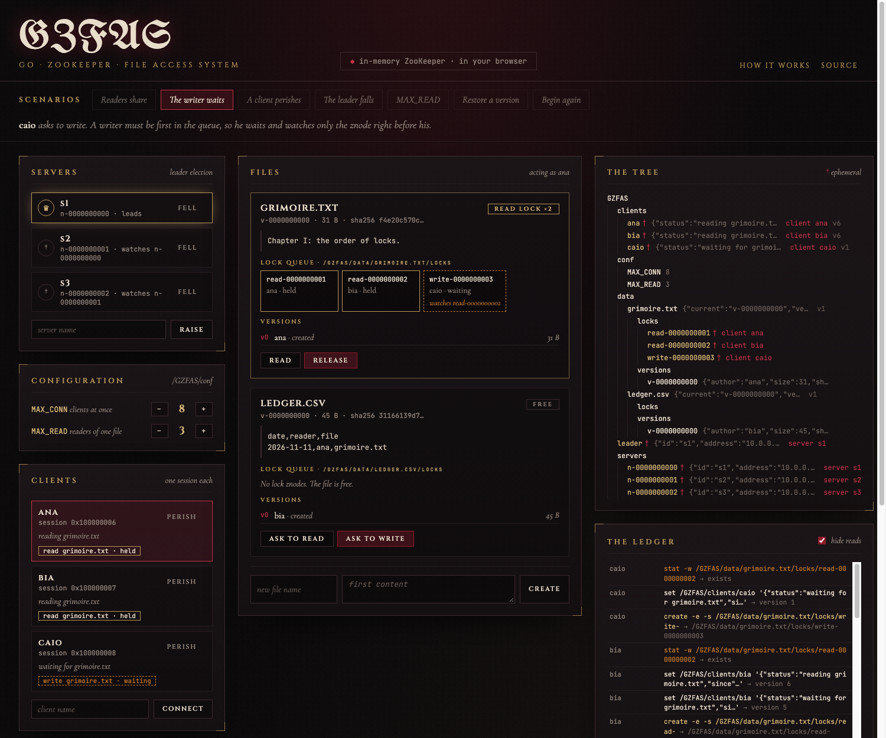
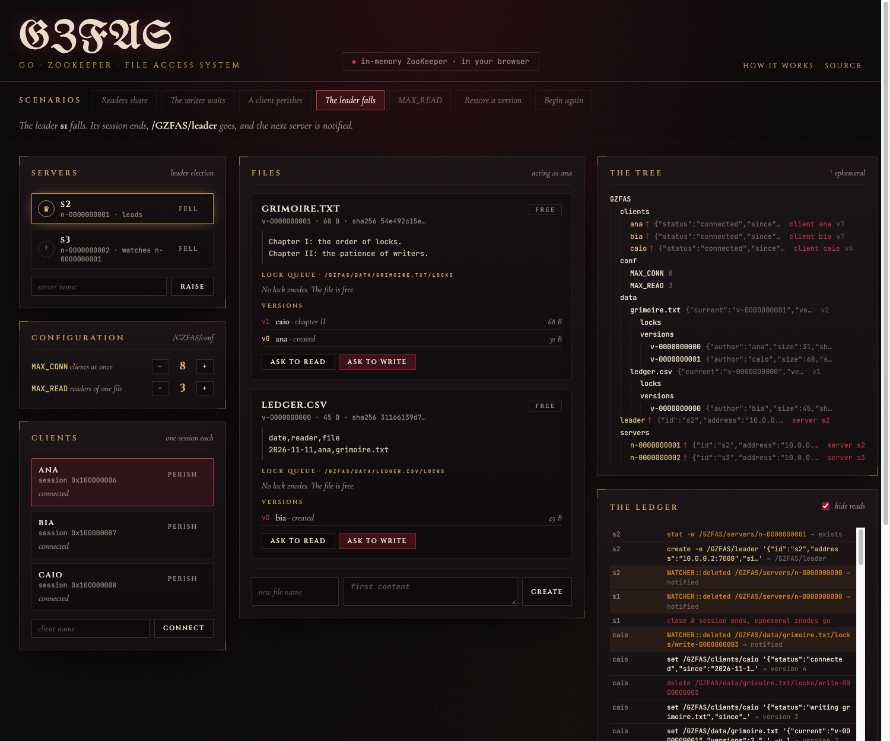

# GZFAS

Go ZooKeeper File Access System: a file system in Go in which ZooKeeper decides who reads and who writes each file. It uses the standard ZooKeeper recipes: readers-writer locks with ephemeral sequential znodes, a version history, and leader election. A dashboard shows every znode and every ZooKeeper call while it happens.

[](https://github.com/rahelmartim/gzfas/actions/workflows/ci.yml)
[](https://rahelmartim.github.io/gzfas/)
[](https://go.dev)

Live demo: https://rahelmartim.github.io/gzfas/

The demo runs GZFAS in your browser with WebAssembly, on an in-memory ZooKeeper that follows the ZooKeeper rules. To run it on a real ZooKeeper, use Docker Compose. The same dashboard then shows the real ensemble.



## What it does

- **Readers-writer locks:** many clients can read a file at the same time. A writer works alone. The queue is fair, so a new reader cannot pass a writer that waits.
- **Crash safety:** each client has its own ZooKeeper session. When a client crashes, ZooKeeper deletes its znodes, and the next client in the queue gets the lock.
- **Versions:** each write adds a version. You can restore an old version, and the history only grows.
- **Limits:** `MAX_CONN` limits the connected clients, and `MAX_READ` limits the readers of one file. You can change both while the system runs.
- **Leader election:** several servers elect one leader. When the leader falls, the next server takes over. Without a leader, clients cannot lock or write.
- **Dashboard:** it shows the live znode tree, the servers, and the clients. For each file, it shows the lock queue and which znode each client watches. A log shows every ZooKeeper call in `zkCli` syntax. Six scenarios run the main cases with a narration.

## How ZooKeeper is used

```text
/GZFAS/conf/MAX_CONN                           persistent   clients at the same time
/GZFAS/conf/MAX_READ                           persistent   readers of one file at the same time
/GZFAS/servers/n-0000000000                    ephemeral, sequential   leader election
/GZFAS/leader                                  ephemeral    the current leader
/GZFAS/clients/<name>                          ephemeral    one per connected client
/GZFAS/data/<file>                             persistent   metadata of the current version
/GZFAS/data/<file>/locks/read-0000000003       ephemeral, sequential   lock queue
/GZFAS/data/<file>/versions/v-0000000001       sequential   version history
```

### Locks

GZFAS uses the [shared lock recipe](https://zookeeper.apache.org/doc/current/recipes.html#Shared+Locks) of ZooKeeper:

1. To lock a file, a client creates an ephemeral sequential znode: `locks/read-` or `locks/write-`.
2. It lists the lock znodes and sorts them by their sequence number.
3. If its znode is the first one, a writer holds the lock. If no write znode comes before its own, a reader holds the lock.
4. Otherwise, the client watches only the znode that blocks it. For a writer, that is the znode right before its own. For a reader, it is the last write znode before its own. So a release wakes one client, not all of them (no "herd effect").
5. When the watch fires, the client goes back to step 2.

`MAX_READ` adds one rule to the recipe: a reader also waits while `MAX_READ` earlier readers hold the file. In that case, it watches the whole `locks/` folder.

### Versions

A write needs the write lock. It creates a sequential znode under `versions/`, saves the content, and updates the file znode with `set -v <version>`. The version check also protects the data: if two writers were wrong about the lock, no update is lost. ZooKeeper keeps only the metadata. The content lives in a blob store (in memory, or in a folder on disk), because a znode holds at most about 1 MB.

### Leader election

GZFAS uses the [election recipe](https://zookeeper.apache.org/doc/current/recipes.html#sc_leaderElection). Each server creates `servers/n-`. The lowest number leads and creates the ephemeral `/GZFAS/leader`. Each other server watches only the server right before its own.



## Getting started

You need Go 1.24 or later.

### The browser demo

```bash
make serve
```

Then open http://localhost:8080. To use another port, run `make serve PORT=8090`.

### With a real ZooKeeper (Docker)

```bash
docker compose up --build
```

Then open http://localhost:8080. Docker Compose starts ZooKeeper 3.9 and `gzfas-server` with three GZFAS servers. The file content is stored in a Docker volume.

To look at the znodes with the official shell:

```bash
docker compose exec zookeeper zkCli.sh ls -R /GZFAS
```

### Without Docker

```bash
go run ./cmd/gzfas-server -zk localhost:2181   # on your ZooKeeper
go run ./cmd/gzfas-server -memory              # on the in-memory store
```

| Flag | Default | Description |
| --- | --- | --- |
| `-addr` | `127.0.0.1:8080` | Address of the dashboard. |
| `-zk` | `localhost:2181` | Comma-separated ZooKeeper servers. |
| `-memory` | `false` | Use the in-memory store instead of ZooKeeper. |
| `-servers` | `s1,s2,s3` | GZFAS servers to start in this process. |
| `-data` | `gzfas-data` | Folder for the file content. Empty keeps it in memory. |

The dashboard has no login, so it listens only on `127.0.0.1` by default. Do not expose it to a network that you do not trust.

## Use the packages

```go
store := &coord.ZooKeeperStore{Servers: []string{"localhost:2181"}}
system, _ := gzfas.New(store, gzfas.DirBlobs{Dir: "data"}, gzfas.Config{MaxConn: 8, MaxRead: 3})
system.StartServer("s1", "10.0.0.1:7000")

ana, _ := system.Connect("ana")
ana.CreateFile("notes.txt", []byte("hello"))

lock, _ := ana.RequestLock("notes.txt", gzfas.Write)
lock.Wait(context.Background())
ana.Write("notes.txt", []byte("hello, world"), "second line")
lock.Release()
```

## Tests

```bash
make test             # Go tests on the in-memory store
make zookeeper        # start ZooKeeper 3.9 in Docker
make test-zookeeper   # the same tests on that ZooKeeper too
make web && node --test web/test/dashboard.test.js   # browser tests
```

`make test-zookeeper` deletes the `/GZFAS` tree of that ZooKeeper. Use a ZooKeeper for tests only.

| Package | What the tests cover |
| --- | --- |
| `coord` | The ZooKeeper contract: versions, sequential and ephemeral znodes, one-time watches, and session ends. The same tests run on the in-memory store and on a real ZooKeeper, so both behave the same. |
| `gzfas` | Shared reads, exclusive writes, and fair queues. The watched znode of each waiter, `MAX_READ`, and `MAX_CONN`. Crashes, versions, rollback, deleted files, and leader failover. 12 clients that lock at the same time. |
| `dashboard` | The actions, the HTTP API, the security headers, the size limit, and the event stream. |
| `web/test` | The dashboard in a headless Chrome: manual locks, an edit with a new version, all six scenarios, errors, and no JavaScript errors. |

CI runs the Go tests on the in-memory store and on a ZooKeeper service, the browser tests, and a Docker build.

## Project structure

```text
cmd/gzfas-server/   # HTTP server with the dashboard
cmd/gzfas-wasm/     # WebAssembly entry point for the browser demo
coord/              # The ZooKeeper API: in-memory store, real ZooKeeper, call recorder
gzfas/              # Locks, files, versions, clients, leader election, snapshots
dashboard/          # Dashboard actions and HTTP API, shared by both entry points
web/                # The dashboard page, and its browser tests
docs/               # Screenshots
```

## History

GZFAS started in 2018 as a distributed systems course project. That version had a design for the znode tree, and a TCP server with the commands `CONNECT`, `READ`, `WRITE`, and `QUIT`. But `READ` and `WRITE` were not finished. In 2026, the project was rebuilt on that design with the ZooKeeper recipes, tests, and the dashboard. The tree changed in one place: in ZooKeeper, an ephemeral znode cannot have children, so each client is now one ephemeral znode with its status as data.

## License

This project uses the MIT license. Read the [LICENSE](LICENSE) file for the full text.
